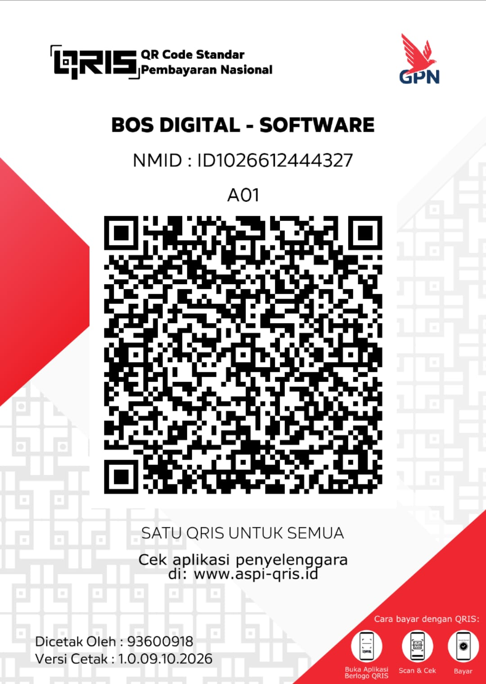

# Poni

An interactive notch for Windows 10 and 11 (formerly "Notch for Windows"). It lives at the top of your screen: hover over it to open it, drag files onto it, or press `Alt+N`.

**[Download the latest version](https://github.com/liimalim/Poni/releases/latest)**: pick `Poni_x.y.z_x64-setup.exe` (recommended, updates itself) or the portable `.exe`. Website and demo video: **[poni.web.id](https://poni.web.id/)**.

## Features

- **Music**: album art with color glow, live visualizer, and controls for any player in the Windows media controls (Spotify, browsers, VLC and more)
- **Dashboard**: weather, quick toggles (keep awake, dark mode, mute mic, lock), app launcher, day progress
- **Calendar**: Google Calendar, Outlook or any iCal (.ics) link, with meeting reminders in the notch
- **Todo** with due times and a countdown in the closed notch, **Notes, Pomodoro, Weather, Health** (water, breaks, breathing, 20-20-20 eye breaks)
- **Wi-Fi & Bluetooth**: radio switches, join Wi-Fi networks right in Poni, connect/disconnect headphones and speakers, device battery levels
- **Screen Time, Day Progress, System stats**
- **Shelf and Drop Actions**: zip, extract, convert images, copy/move, OneDrive, Share, Recycle Bin
- **Snap Zones**: drag a window onto the notch to tile it
- **HUD** for volume and brightness, a **clock** in the closed notch when nothing else is going on, and an optional 3D cat that watches your mouse
- **AI Chat** and **Translate** with Google Gemini (free API key from Google AI Studio), Claude, any OpenAI-compatible API, or local Ollama
- **GitHub** pull requests waiting for your review

## Updates

The installed (Setup) version checks this page for new versions and updates itself (Settings → About). Every update is signed, so Poni only installs files signed by the author. The portable version shows a notice instead.

Coming from Notch for Windows? Nothing to do: Notch updates itself to Poni, removes the old install and keeps your settings, todos and notes.

## Support

Poni is free. If it helps you, you can treat the developer to a coffee:

- **[Support on Gumroad](https://bosdigital.gumroad.com/l/notch-for-windows)** (international: card or PayPal, pay what you want)
- **QRIS** (Indonesia: GoPay, OVO, DANA, ShopeePay, mobile banking)

  

In Poni, click the cup button next to the settings gear (or open Settings → About). Made by **Alim AJ** · Bos Digital.

## Requirements

Windows 10/11 64-bit with Microsoft Edge WebView2 (already included in Windows 11 and up-to-date Windows 10).

Listing Wi-Fi networks needs location access for desktop apps on Windows 11 (Settings → Privacy & security → Location); Poni shows a button for it.

Windows SmartScreen may warn on first run because the app isn't code-signed with a paid certificate: click **More info → Run anyway**.

## Privacy

Everything stays on your PC (`%APPDATA%\Poni`). Network is only used for the things you turn on: weather (Open-Meteo), your calendar links, GitHub, AI chat and translation (the provider you pick), and update checks. AI chats stay on this PC until you start a new chat.

## Changelog

What changed in every version: see [CHANGELOG.md](CHANGELOG.md).

---

**Bahasa Indonesia:** Poni adalah notch interaktif di bagian atas layar Windows (dulu bernama Notch for Windows). Unduh **Setup** dari [Releases](https://github.com/liimalim/Poni/releases/latest) supaya Poni bisa update otomatis. Kalau Poni bermanfaat, kamu bisa traktir developernya lewat QRIS di atas.
